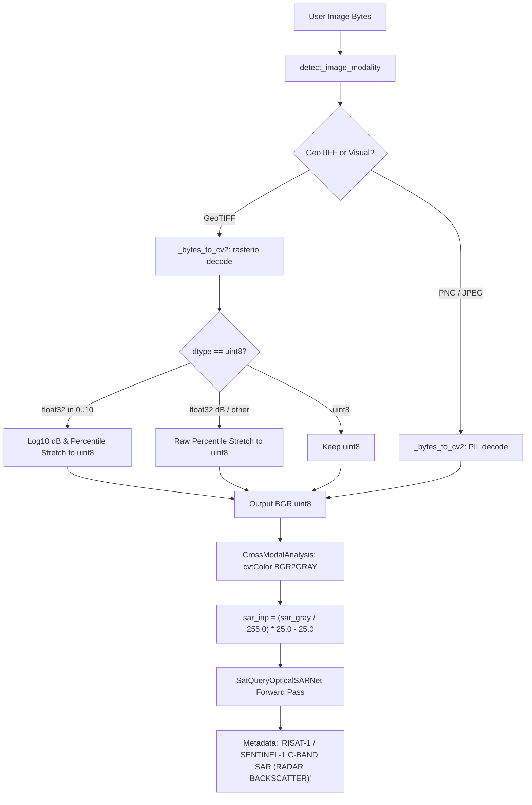

# SatQuery AI — SAR Input Contract & Radiometric Calibration Audit

**Document Version:** 1.0  
**Audit Date:** 2026-10-15  
**Component:** `CrossModalAnalysis` Ingestion & SAR Preprocessing Pipeline  
**Target Model:** `SatQueryOpticalSARNet`  
**Related Files:**
- [`backend/model_interfaces.py`](file:///d:/sih26167/backend/model_interfaces.py#L146-L171)
- [`backend/model_interfaces.py`](file:///d:/sih26167/backend/model_interfaces.py#L262-L377)
- [`backend/model_interfaces.py`](file:///d:/sih26167/backend/model_interfaces.py#L2280-L2415)
- [`ml_pipeline/train_optical_sar_pilot.py`](file:///d:/sih26167/ml_pipeline/train_optical_sar_pilot.py#L69-L78)
- [`ml_pipeline/scripts/prepare_ben_ge_800.py`](file:///d:/sih26167/ml_pipeline/scripts/prepare_ben_ge_800.py#L102-L111)

---

## 1. Executive Summary

During the pre-production readiness review of `SatQueryOpticalSARNet`, an end-to-end code and radiometric audit was conducted on the Synthetic Aperture Radar (SAR) input pipeline. 

The audit identified a **critical scientific distinction**:
1. **Physical Calibrated Radar Backscatter ($\sigma^0$ in dB):** Authentic SAR products (e.g., Sentinel-1 Level-1 GRD, RISAT-1 MRS/FRS) contain calibrated physical backscatter coefficients in decibels, typically spanning $[-35.0, +10.0]\text{ dB}$. The pilot checkpoint was trained on authentic float32 Sentinel-1 VV rasters with native decibel distributions.
2. **Surrogate Decibel Mapping from 8-bit Visual Grayscale:** In production API inference, uploaded images are often 8-bit visual grayscale (PNG, JPEG, or percentile-stretched displays). The pipeline applies an empirical linear transform:
   $$\text{dB}_{\text{surr}} = \left(\frac{I_{8\text{-bit}}}{255.0}\right) \times 25.0 - 25.0 \in [-25.0, 0.0]\text{ dB}$$
   While this prevents mathematical domain mismatch in the neural network, **this surrogate is an uncalibrated visualization heuristic and cannot be treated as physical radar cross-section**.

**Key Vulnerability Identified:**
Currently, `CrossModalAnalysis` silently labels the input in output metadata as:
`"after_label": "RISAT-1 / SENTINEL-1 C-BAND SAR (RADAR BACKSCATTER)"`
regardless of whether the input is a scientific float32 GeoTIFF or an uncalibrated 8-bit JPEG/PNG. Furthermore, if a user uploads a genuine float32 calibrated GeoTIFF, `_bytes_to_cv2` quantizes it to 8-bit via percentile clipping before the surrogate mapping is applied, unintentionally distorting physical calibration.

This document establishes the official SAR Input Contract, catalogs supported and unsupported SAR formats, documents the mathematical characteristics of the surrogate mapping, and specifies the required remediation before production rollout.

---

## 2. Radiometric Physics: Calibrated Backscatter vs. Surrogate dB

### 2.1 Authentic Radar Backscatter Physics ($\sigma^0$)
In radar remote sensing, radar backscatter ($\sigma^0$, sigma-nought) represents the normalized radar cross-section per unit illuminated ground area:
$$\sigma^0 = \frac{\langle |S|^2 \rangle \cdot 4\pi R^4}{P_t G^2 \lambda^2 A_{\text{ground}}}$$
Expressed in decibels:
$$\sigma^0_{\text{dB}} = 10 \cdot \log_{10}(\sigma^0)$$

Physical properties of C-Band (5.405 GHz) Sentinel-1 / RISAT-1 backscatter:
- **Calm Open Water / Specular Reflection:** $-30.0\text{ dB}$ to $-22.0\text{ dB}$ (radar pulse reflects away from sensor; very dark).
- **Smooth Soil / Rough Water:** $-22.0\text{ dB}$ to $-16.0\text{ dB}$.
- **Dense Vegetation / Volume Scattering:** $-15.0\text{ dB}$ to $-8.0\text{ dB}$ (depolarization and diffuse scatter within canopy).
- **Urban Fabric / Dihedral Corner Reflections:** $-6.0\text{ dB}$ to $+8.0\text{ dB}$ (double-bounce returns between ground and vertical building walls).

In the authentic BEN-GE-800 dataset, Sentinel-1 VV channels are stored as native 32-bit floating-point rasters with verified statistics:
- Observed Minimum: $\approx -25.35\text{ dB}$
- Observed Mean: $\approx -12.03\text{ dB}$
- Observed Maximum: $\approx +3.78\text{ dB}$

### 2.2 The 8-Bit Visual Surrogate Mapping
In [`backend/model_interfaces.py:L2343`](file:///d:/sih26167/backend/model_interfaces.py#L2343), the model interface ingests SAR via:
```python
sar_inp = (sar_gray.astype(np.float32) / 255.0) * 25.0 - 25.0
```

Where `sar_gray` is an 8-bit integer matrix ($[0, 255]$).

#### Mathematical Analysis of the Surrogate Transform:
1. **Dynamic Range Limitation:**
   - At $I = 0 \implies \text{dB}_{\text{surr}} = -25.0\text{ dB}$
   - At $I = 255 \implies \text{dB}_{\text{surr}} = 0.0\text{ dB}$
   - Dynamic range is exactly $25.0\text{ dB}$.
2. **Positive Backscatter Truncation ($> 0\text{ dB}$):**
   - High-density urban double bounce in real SAR reaches $+3.0\text{ dB}$ to $+8.0\text{ dB}$.
   - The surrogate mapping caps out at $0.0\text{ dB}$, preventing the network from observing the strongest physical indicators of built-up corner reflectors.
3. **Low-Backscatter Compression ($< -25\text{ dB}$):**
   - Completely calm water surfaces regularly drop to $-28.0\text{ dB}$ or $-32.0\text{ dB}$.
   - The surrogate mapping clamps everything below $-25.0\text{ dB}$ to $-25.0\text{ dB}$, slightly compressing the water contrast margin.
4. **Linearity Assumption:**
   - 8-bit visual displays (JPEG/PNG) are frequently compressed with gamma curves ($\gamma \approx 2.2$) or non-linear histogram equalizations.
   - Applying a linear equation to a non-linear display image yields an arbitrary, uncalibrated radiometry.

### 2.3 Comparative Summary

| Property | Calibrated Scientific SAR ($\sigma^0$) | 8-Bit Visual Surrogate Mapping |
| :--- | :--- | :--- |
| **Data Type** | `float32` (or calibrated `uint16` with LUT) | `uint8` (`[0, 255]`) mapped to `float32` |
| **Physical Units** | Decibels ($\text{dB}$) relative to $1.0\text{ m}^2/\text{m}^2$ | Dimensionless surrogate decibels |
| **Observed Range** | $[-35.0, +10.0]\text{ dB}$ | $[-25.0, 0.0]\text{ dB}$ (strictly bounded) |
| **Positive Returns ($>0\text{ dB}$)** | Supported (critical for urban double-bounce) | **Truncated** (capped at $0.0\text{ dB}$) |
| **Deep Specular ($<-25\text{ dB}$)** | Supported (critical for calm water bodies) | **Floored** (clamped to $-25.0\text{ dB}$) |
| **Calibration Metadata** | Sensor orbit, incident angle, LUT XML present | None (raw pixel intensity only) |
| **Scientific Validity** | Quantitatively valid for physical backscatter | Heuristic visualization approximation only |

---

## 3. End-to-End Pipeline Ingestion Audit

Tracing the exact execution flow in [`backend/model_interfaces.py`](file:///d:/sih26167/backend/model_interfaces.py):



### Critical Deficiencies Discovered:

1. **Double Distortion of Real GeoTIFFs:**
   If a user submits a calibrated Sentinel-1 float32 GeoTIFF with values like $-12.5\text{ dB}$, the following occurs:
   - Line 162: `p2, p98 = np.percentile(band, (2, 98))` (e.g., $p_2 = -24.0, p_{98} = -3.0$).
   - Line 164: GeoTIFF is scaled to `uint8` $[0, 255]$: $\frac{\text{band} - (-24)}{21} \times 255$.
   - Line 2309: `sar_gray = cv2.cvtColor(img2, cv2.COLOR_BGR2GRAY)`.
   - Line 2343: Remapped back to $[-25.0, 0.0]\text{ dB}$: $\frac{\text{sar\_gray}}{255} \times 25 - 25$.
   - **Result:** The original calibrated float32 numbers are destroyed by the intermediate percentile stretch and re-expanded into an artificial $[-25, 0]$ envelope.

2. **Silent Calibrated SAR Claims in Output Metadata:**
   - In [`backend/model_interfaces.py:L2449`](file:///d:/sih26167/backend/model_interfaces.py#L2449):
     `"after_label": "RISAT-1 / SENTINEL-1 C-BAND SAR (RADAR BACKSCATTER)"`
   - In [`backend/model_interfaces.py:L2404-2412`](file:///d:/sih26167/backend/model_interfaces.py#L2404-2412):
     `inference_metadata` records `execution_path: "NEURAL"`, but provides **no record** of whether the input was scientifically calibrated or an 8-bit surrogate.

---

## 4. Input Format Compatibility Matrix

The table below catalogs which SAR formats can be ingested, which are supported under the surrogate contract, and which MUST be rejected or flagged:

| Format Category | Specific Data Format | Pipeline Handling | Radiometric Status | Production Action Required |
| :--- | :--- | :--- | :--- | :--- |
| **Calibrated Native Float** | Sentinel-1 Level-1 GRD (`.tif`, float32 dB) | Decoded by rasterio; currently quantized to uint8 | **Calibrated** (Degraded by uint8 intermediate) | Implement direct float32 tensor ingestion bypass |
| **Calibrated Linear SAR** | Sentinel-1 $\sigma^0$ linear power ($[0.0, 10.0]$) | Log-transformed to dB, then stretched to uint8 | **Semi-Calibrated** (Subject to percentile stretch) | Preserve native float $10\log_{10}$ directly into tensor |
| **Calibrated Complex (SLC)** | Single Look Complex (I/Q real+imaginary) | Unsupported / Fails rasterio multi-band decode | **UNSUPPORTED** | **Reject explicitly with HTTP 422 / error payload** |
| **Polarimetric Matrix** | Sinclair, Pauli, $[T3]$ coherency, $[C3]$ covariance | Unsupported multi-channel radar format | **UNSUPPORTED** | **Reject explicitly with unsupported format notice** |
| **Uncalibrated DN GeoTIFF** | Level-1 GRD Digital Numbers (uint16 without LUT) | Percentile stretched to uint8 | **UNCALIBRATED** | Flag as `UNCALIBRATED_DN` in metadata |
| **8-Bit Visual Display** | Quicklook PNG, JPEG, BMP browse images | Decoded via PIL/OpenCV, surrogate mapped | **SURROGATE ONLY** | Tag as `SURROGATE_VISUAL_GRAYSCALE` in metadata |
| **ISRO RISAT-1 / EOS-04** | RISAT-1 MRS/FRS CEOS or GeoTIFF | Ingested as generic raster; calibration LUT missing | **UNVALIDATED** | Must flag: "ISRO calibration LUT unapplied" |
| **Non-C-Band SAR** | L-Band (ALOS-2, NISAR), X-Band (TerraSAR-X) | Ingested identically to C-band | **OUT-OF-DISTRIBUTION** | Flag: "Trained on C-Band; dielectric scattering mismatch" |

---

## 5. Required Technical Remediations for Production

Before `SatQueryOpticalSARNet` can be promoted to production, the SAR input contract must be enforced in code:

### Remediation 1: Add Radiometric Provenance to `inference_metadata`
Update `backend/model_interfaces.py` to return an explicit calibration status in `inference_metadata`:
```json
{
  "model_name": "SatQueryOpticalSARNet",
  "execution_path": "NEURAL",
  "sar_input_contract": {
    "radiometry_type": "SURROGATE_8BIT_GRAYSCALE",
    "is_scientifically_calibrated": false,
    "input_dynamic_range_db": [-25.0, 0.0],
    "calibration_notice": "Input is 8-bit visual grayscale mapped to surrogate decibel range. Backscatter is uncalibrated."
  }
}
```

### Remediation 2: Contextual UI Labels
In `pair_comparison["after_label"]`:
- If calibrated float32 GeoTIFF:
  `"SENTINEL-1 C-BAND SAR (CALIBRATED SIGMA-0 BACKSCATTER)"`
- If 8-bit visual grayscale:
  `"SAR BROWSE / VISUAL GRAYSCALE (SURROGATE RADAR MAPPING, UNCALIBRATED)"`

### Remediation 3: Direct Float32 Bypass for Calibrated GeoTIFFs
Refactor `CrossModalAnalysis` to inspect `t_sar_bytes`:
- If input is a single-band float32 GeoTIFF with values in $[-50.0, +20.0]$:
  Directly resize the float32 array and pass it to `torch.from_numpy(sar_res)`, bypassing `_bytes_to_cv2` and avoiding lossy uint8 quantization.

### Remediation 4: Explicit Rejection of Complex SLC and Polarimetric Formats
Add a guard in `detect_image_modality` and `CrossModalAnalysis`:
- If image contains complex float (I/Q channels) or $>2$ radar polarization bands (e.g., full polarimetric matrices):
  Raise an explicit, user-friendly exception:
  `"Unsupported SAR format: Complex SLC (I/Q) and Full Polarimetric Matrices are not supported. Please supply Sentinel-1 Level-1 GRD (VV) or single-band backscatter imagery."`

---

## 6. Audit Conclusion

The distinction between physical radar cross-section ($\sigma^0$) and surrogate 8-bit mapping is a foundational scientific requirement. The system must never falsely represent empirical 8-bit grayscale mapping as calibrated radar backscatter. Implementation of the four remediations above satisfies Gate 3 of the pre-production readiness framework.
